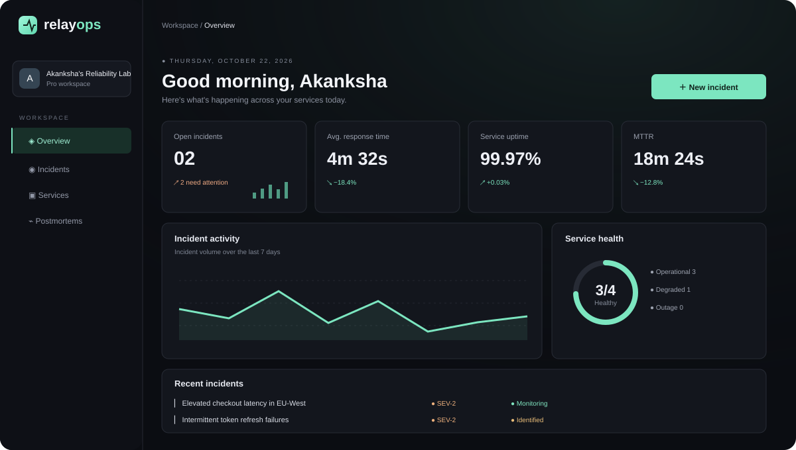

# RelayOps — Incident Intelligence & Reliability Workspace

> **Author:** Akanksha Deshmukh · **Contact:** akankshadeshmukh651@gmail.com
>
> A production-minded full-stack portfolio project designed to demonstrate the engineering judgment expected at strong product companies, high-growth startups, and international software teams.

RelayOps is a reliability operations workspace for engineering teams. It brings incidents, service health, ownership, and post-incident learning into one focused interface. The repository is intentionally structured as a real product rather than a one-page CRUD demo.



<p align="center">
  <strong>Incident response, service health, and operational learning — in one calm command center.</strong>
</p>

<p align="center">
  <a href="#quick-start">Quick start</a> ·
  <a href="#product-scope">Product scope</a> ·
  <a href="#architecture">Architecture</a> ·
  <a href="docs/INTERVIEW_GUIDE.md">Interview guide</a> ·
  <a href="docs/PORTFOLIO_CHECKLIST.md">Portfolio checklist</a>
</p>

<p align="center">
  
  
  
  
</p>

## Why this project stands out

- **Real product problem:** incident response and service reliability are important to SaaS, fintech, infrastructure, and developer-tool companies.
- **Full-stack architecture:** React + TypeScript frontend, Express API, PostgreSQL, Prisma, Zod validation, JWT access tokens, and role-based authorization.
- **Engineering fundamentals:** layered API routes, service functions, centralized error handling, pagination, request IDs, structured logging, tests, Docker Compose, and environment validation.
- **Portfolio-ready UX:** responsive dark command-center interface, information hierarchy, thoughtful empty states, status badges, charts, and keyboard-friendly controls.
- **Interview discussion material:** trade-offs, data model, API contracts, security boundaries, observability, scaling path, and testing strategy are documented.

**Important:** This is a strong portfolio foundation, not a guarantee of employment or a claim that it is production-certified. Before presenting it as production-ready, complete the hardening checklist below and deploy it yourself.

## Product scope

### Included in this repository
- Overview dashboard with reliability KPIs, incident trends, service status, and recent incidents.
- Incident list with search and severity/status filtering.
- Create and update incidents through a typed REST API.
- Role-aware incident mutation and explicit API error contracts.
- Services catalogue with health status and ownership.
- Demo seed data for a realistic first run.
- JWT authentication scaffold and role-aware API middleware.
- PostgreSQL schema and Prisma migrations workflow.
- Docker Compose for local PostgreSQL.
- API tests and a deployment/security checklist.
- Incident lifecycle audit events, transactionally coupled to incident writes, with a read-only timeline endpoint.
- System design notes, security threat/hardening checklist, SLO response playbook, and architecture decision records.

### Deliberately not faked
The UI uses live API responses when configured. The frontend has a clearly labelled demo-data fallback for design review when the API is not running. The “AI” or automated diagnosis functionality is **not** claimed as implemented; a future extension is documented as an integration point.

## Advanced engineering notes

- [System design and scaling path](docs/SYSTEM_DESIGN.md)
- [Security model and production hardening](docs/SECURITY.md)
- [SLO and incident-response playbook](docs/SLO_PLAYBOOK.md)
- [Architecture decision records](docs/adr/)
- [API reference, including incident timeline](docs/API.md)

The repository demonstrates several production-oriented patterns, but it is not yet a fully production-ready hosted service. The security document calls out implemented controls and remaining gaps separately.

## Architecture

```text
relayops/
├── apps/
│   ├── web/                 # React, Vite, TypeScript, Tailwind
│   └── api/                 # Express, TypeScript, Prisma, Zod
├── packages/
│   └── shared/              # Shared API types and constants
├── docs/
│   ├── ARCHITECTURE.md
│   ├── API.md
│   ├── INTERVIEW_GUIDE.md
│   ├── ROADMAP.md
│   └── product-preview.svg
├── docker-compose.yml
├── .env.example
└── README.md
```

### Request flow

```text
Browser UI
   │ HTTPS / JSON
   ▼
Express API ── request ID + structured logs
   │
   ├── Zod validation
   ├── JWT authentication
   ├── role/ownership authorization
   ├── domain service layer
   ▼
Prisma ORM
   │
   ▼
PostgreSQL
```

## Quick start

### Prerequisites
- Node.js 20+
- npm 10+
- Docker Desktop (recommended) or a PostgreSQL 15+ instance

### 1. Configure environment

```bash
cp .env.example .env
```

Generate a strong local JWT secret rather than reusing an example value:

```bash
openssl rand -base64 48
```

Put the generated value in `JWT_SECRET`.

### 2. Start PostgreSQL

```bash
docker compose up -d db
```

### 3. Install dependencies

```bash
npm install
```

### 4. Generate Prisma client and create tables

```bash
npm run db:generate
npm run db:migrate
npm run db:seed
```

### 5. Run the app

```bash
npm run dev
```

- Web: http://localhost:5173
- API health: http://localhost:4000/health
- API base: http://localhost:4000/api/v1

If you only want to review the visual interface, start the web app alone. The dashboard includes an explicit demo-data fallback until the API is available.

## Local seed account

The seed script creates the project owner profile **Akanksha Deshmukh** (`akankshadeshmukh651@gmail.com`) only when `SEED_DEMO_PASSWORD` is set. Set a unique local password before seeding. This is a local development identity, not a hosted account or authentication service. Never reuse the local password in a deployed environment.

## Useful commands

```bash
npm run dev              # web + API concurrently
npm run build            # build all workspaces
npm run lint             # lint all workspaces
npm run test             # run API tests
npm run db:generate      # generate Prisma client
npm run db:migrate       # apply local migrations
npm run db:seed          # seed demo data
```

## Environment variables

| Variable | Purpose |
|---|---|
| `DATABASE_URL` | PostgreSQL connection string |
| `JWT_SECRET` | Secret used to sign access tokens; use a long random value |
| `JWT_EXPIRES_IN` | Access token lifetime |
| `API_PORT` | API port |
| `WEB_ORIGIN` | Allowed frontend origin for CORS |
| `SEED_DEMO_PASSWORD` | Optional local-only demo seed password |

## Quality bar: before you call it production-ready

- [ ] Add refresh-token rotation in secure, HttpOnly cookies and session revocation.
- [ ] Add rate limiting, CSRF strategy if cookie auth is used, and brute-force protection.
- [ ] Add email verification, password reset, and invitation flow.
- [x] Add transactional incident lifecycle events and a chronological timeline endpoint. (The database owner can still alter records; this is not cryptographically immutable.)
- [ ] Add OpenTelemetry traces, metrics, and dashboards.
- [ ] Add CI for typecheck, lint, unit/integration tests, dependency scanning, and builds.
- [ ] Add API contract tests and end-to-end browser tests.
- [ ] Add backup/restore drills, database migration rollback strategy, and SLOs.
- [ ] Configure secrets management, HTTPS, CSP, and production CORS.
- [ ] Run accessibility checks with keyboard-only navigation and a screen reader.
- [ ] Deploy a staging environment and document actual uptime/performance measurements.

## Author profile

**Akanksha Deshmukh**  
Email: [akankshadeshmukh651@gmail.com](mailto:akankshadeshmukh651@gmail.com)

Before publishing, add your actual GitHub, LinkedIn, and deployed demo URLs. Do not invent links or claim production usage that you have not completed.

## How to make this portfolio genuinely competitive

1. **Ship a live deployment.** Use a managed PostgreSQL service and deploy the web/API separately or as a monorepo.
2. **Show engineering evidence.** Add CI badges only after workflows pass; publish test coverage and a short architecture decision record.
3. **Record a 90-second demo.** Show incident creation, filtering, service status, and one failure/empty state.
4. **Write a case study.** Explain the user problem, architecture choices, trade-offs, test strategy, and what you would change at 10× traffic.
5. **Add one hard differentiator.** Recommended next feature: event ingestion endpoint + deduplication + incident correlation using a queue.
6. **Keep claims honest.** Never list scale, users, uptime, or AI capabilities that you have not actually measured or built.

## Resume bullet template

Use only after you have implemented and verified the details:

> Built RelayOps, a full-stack incident intelligence workspace using React, TypeScript, Express, PostgreSQL, and Prisma; implemented validated REST APIs, role-aware access control, seeded operational data, and a responsive reliability dashboard.

Add measurable outcomes only after you have real measurements.

## License

MIT. See `LICENSE`.
